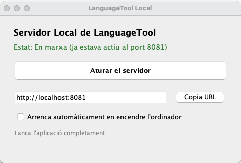

# LanguageToolLocal

🌐 **Idioma / Language:** [Català](#català) | [English](#english) | [Español](#español)

*(Substitueix `screenshot.png` pel nom real de la imatge que pugis al repositori / Replace `screenshot.png` with your actual image filename)*

---

## Català

**LanguageToolLocal** és una aplicació d'escriptori lleugera i fàcil d'utilitzar que posa en marxa un servidor local de [LanguageTool](https://languagetool.org/) al teu ordinador amb un sol clic, sense necessitat d'instal·lar Java ni configurar fitxers manualment.

### 1. Descàrrega i arrencada (Windows, macOS i Linux)

1. Ves a l'apartat de **[Releases](https://github.com/aoliverg/LanguageToolLocal/releases)** i descarrega el paquet corresponent al teu sistema operatiu:
   * **Windows:** `LanguageToolLocal-Windows.zip`
   * **macOS:** `LanguageToolLocal-Mac-AppleSilicon.dmg` (Macs amb xip M1/M2/M3/M4) o `LanguageToolLocal-Mac-Intel.dmg` (Macs antics amb Intel)
   * **Linux:** `LanguageToolLocal-Linux.tar.gz`
2. **Com posar-lo en marxa:**
   * **Windows:** Descomprimeix el fitxer `.zip` en una carpeta (per exemple, dins de *Documents* o *Programes*) i fes doble clic sobre **`LanguageToolLocal.exe`**. *(Si Windows mostra un avís de SmartScreen, fes clic a "Més informació" -> "Executa igualment").*
   * **macOS:** Obre el fitxer `.dmg`, arrossega **`LanguageToolLocal`** a la carpeta *Aplicacions* i obre'l. *(La primera vegada, potser hauràs de fer clic amb el botó dret -> "Obre" per autoritzar-lo a macOS).*
   * **Linux:** Descomprimeix el fitxer `.tar.gz` i fes doble clic sobre **`Inicia_LanguageTool`** (o executa `./LanguageToolLocal/bin/LanguageToolLocal` des del terminal).
3. **Ús de l'aplicació:**
   * En obrir-se, el servidor arrenca automàticament a l'adreça `http://localhost:8081`.
   * Pots tancar la finestra principal amb la **X**: l'aplicació continuarà funcionant discretament en segon pla a la safata del sistema (al costat del rellotge) o a la barra superior de Mac.
   * Marca la casella **"Arrenca automàticament en encendre l'ordinador"** si vols que s'activi sol cada vegada que iniciïs sessió.

---

### 2. Configuració als navegadors (Chrome, Firefox, Edge, Brave...)

La configuració és **exactament la mateixa a tots els navegadors web**, ja que tots utilitzen la mateixa extensió oficial de LanguageTool:

1. Instal·la l'extensió oficial de **LanguageTool** per a [Google Chrome](https://chromewebstore.google.com/) o [Mozilla Firefox](https://addons.mozilla.org/) (també funciona a Edge, Brave o Opera).
2. Fes clic a la icona de l'extensió de LanguageTool a la barra del navegador i obre la **Configuració** (icona de l'engranatge ⚙️).
3. Baixa fins a l'apartat **Configuració avançada** (*només per a usuaris professionals*).
4. A l'opció **Servidor de LanguageTool**, selecciona **Servidor local (`localhost`)** (o introdueix manualment `http://localhost:8081/v2`).
5. Desa els canvis. A partir d'ara, totes les correccions es faran al 100% en local i de manera privada al teu ordinador.

---

### 3. Ús en altres aplicacions d'escriptori

Com que el servidor queda actiu a `http://localhost:8081/v2`, també el pots connectar amb altres programes compatibles amb LanguageTool:

* **LibreOffice (Writer, Impress, Calc):** Ves a *Eines -> Opcions -> Configuració de la llengua -> LanguageTool*. Activa'l, deixa el camp de l'URL base amb `http://localhost:8081/v2` (deixa l'usuari i la clau API en blanc) i prem *D'acord*.
* **Mozilla Thunderbird:** Instal·la el complement oficial *LanguageTool* per al correu i configura el servidor local a les seves opcions.
* **Altres editors:** També és compatible amb connectors de **Obsidian**, **Visual Studio Code** (extensió *LTeX+*) o **TeXstudio**.

---

### 4. Compilació des del codi font (per a desenvolupadors)

Si vols compilar el projecte tu mateix, consulta les guies específiques:
* [Instruccions per a Linux](readme-linux.md)
* [Instruccions per a Windows](readme-windows.md)
* [Instruccions per a macOS](readme-mac.md)

---
---

## English

**LanguageToolLocal** is a lightweight, user-friendly desktop application that launches a local [LanguageTool](https://languagetool.org/) server on your computer with a single click—no Java installation or manual script configuration required.

### 1. Download and Launch (Windows, macOS, and Linux)

1. Go to the **[Releases](https://github.com/aoliverg/LanguageToolLocal/releases)** section and download the package for your operating system:
   * **Windows:** `LanguageToolLocal-Windows.zip`
   * **macOS:** `LanguageToolLocal-Mac-AppleSilicon.dmg` (M1/M2/M3/M4 Macs) or `LanguageToolLocal-Mac-Intel.dmg` (older Intel Macs)
   * **Linux:** `LanguageToolLocal-Linux.tar.gz`
2. **How to run it:**
   * **Windows:** Extract the `.zip` archive into a folder and double-click **`LanguageToolLocal.exe`**. *(If Windows SmartScreen appears, click "More info" -> "Run anyway").*
   * **macOS:** Open the `.dmg` file, drag **`LanguageToolLocal`** into your *Applications* folder, and launch it. *(On first launch, you may need to right-click -> "Open" to bypass Gatekeeper).*
   * **Linux:** Extract the `.tar.gz` archive and double-click **`Inicia_LanguageTool`** (or run `./LanguageToolLocal/bin/LanguageToolLocal` from the terminal).
3. **Using the app:**
   * Upon launch, the server automatically starts at `http://localhost:8081`.
   * Closing the main window (**X**) minimizes the app to the system tray (Windows/Linux) or the top menu bar (macOS) so it keeps running quietly in the background.
   * Check **"Arrenca automàticament en encendre l'ordinador"** (*Start automatically at login*) if you want it to run every time you turn on your computer.

---

### 2. Browser Extension Setup (Chrome, Firefox, Edge, Brave...)

The configuration process is **identical across all web browsers**, as they all use the same official LanguageTool extension interface:

1. Install the official **LanguageTool** add-on for [Google Chrome](https://chromewebstore.google.com/) or [Mozilla Firefox](https://addons.mozilla.org/) (also compatible with Edge, Brave, and Opera).
2. Click the LanguageTool icon in your browser toolbar and open **Settings** (gear icon ⚙️).
3. Scroll down to **Advanced settings** (*only for professional users*).
4. Under **LanguageTool server**, select **Local server (`localhost`)** (or enter `http://localhost:8081/v2`).
5. Save your settings. Your browser will now check all your texts locally and privately on your own machine.

---

### 3. Using with Other Desktop Applications

Because the server runs at `http://localhost:8081/v2`, you can also connect it to other desktop software:

* **LibreOffice (Writer, Impress, Calc):** Go to *Tools -> Options -> Language Settings -> LanguageTool*. Enable it, set the Base URL to `http://localhost:8081/v2` (leave username and API key blank), and click *OK*.
* **Mozilla Thunderbird:** Install the official *LanguageTool* extension and point it to the local server in its settings.
* **Other Editors:** Works seamlessly with plugins for **Obsidian**, **Visual Studio Code** (*LTeX+* extension), and **TeXstudio**.

---

### 4. Building from Source (For Developers)

If you want to build the packages yourself, check the platform-specific guides:
* [Linux Build Instructions](readme-linux.md)
* [Windows Build Instructions](readme-windows.md)
* [macOS Build Instructions](readme-mac.md)

---
---

## Español

**LanguageToolLocal** es una aplicación de escritorio ligera y sencilla que pone en marcha un servidor local de [LanguageTool](https://languagetool.org/) en tu ordenador con un solo clic, sin necesidad de instalar Java ni configurar archivos manualmente.

### 1. Descarga y ejecución (Windows, macOS y Linux)

1. Ve a la sección de **[Releases](https://github.com/aoliverg/LanguageToolLocal/releases)** y descarga el paquete correspondiente a tu sistema operativo:
   * **Windows:** `LanguageToolLocal-Windows.zip`
   * **macOS:** `LanguageToolLocal-Mac-AppleSilicon.dmg` (Mac con chip M1/M2/M3/M4) o `LanguageToolLocal-Mac-Intel.dmg` (Mac antiguos con Intel)
   * **Linux:** `LanguageToolLocal-Linux.tar.gz`
2. **Cómo ponerlo en marcha:**
   * **Windows:** Descomprime el archivo `.zip` en una carpeta y haz doble clic sobre **`LanguageToolLocal.exe`**. *(Si aparece el aviso de Windows SmartScreen, haz clic en "Más información" -> "Ejecutar de todas formas").*
   * **macOS:** Abre el archivo `.dmg`, arrastra **`LanguageToolLocal`** a la carpeta *Aplicaciones* y ábrelo. *(La primera vez puede que debas hacer clic derecho -> "Abrir" para autorizarlo).*
   * **Linux:** Descomprime el archivo `.tar.gz` y haz doble clic sobre **`Inicia_LanguageTool`** (o ejecuta `./LanguageToolLocal/bin/LanguageToolLocal` desde la terminal).
3. **Uso de la aplicación:**
   * Al abrirse, el servidor arranca automáticamente en `http://localhost:8081`.
   * Si cierras la ventana principal (**X**), la aplicación seguirá ejecutándose en segundo plano en la bandeja del sistema (junto al reloj) o en la barra superior de Mac.
   * Marca la casilla **"Arrenca automàticament en encendre l'ordinador"** (*Arrancar automáticamente al encender el ordenador*) si quieres que se inicie solo cada vez que enciendas el equipo.

---

### 2. Configuración en los navegadores (Chrome, Firefox, Edge, Brave...)

La configuración es **exactamente la misma en todos los navegadores web**, ya que todos utilizan la misma extensión oficial de LanguageTool:

1. Instala la extensión oficial de **LanguageTool** para [Google Chrome](https://chromewebstore.google.com/) o [Mozilla Firefox](https://addons.mozilla.org/) (también funciona en Edge, Brave u Opera).
2. Haz clic en el icono de LanguageTool en la barra del navegador y abre la **Configuración** (icono del engranaje ⚙️).
3. Baja hasta el apartado **Configuración avanzada** (*solo para usuarios profesionales*).
4. En la opción **Servidor de LanguageTool**, selecciona **Servidor local (`localhost`)** (o introduce `http://localhost:8081/v2`).
5. Guarda los cambios. A partir de ahora, las correcciones se realizarán de forma 100 % local y privada en tu ordenador.

---

### 3. Uso en otras aplicaciones de escritorio

Como el servidor permanece activo en `http://localhost:8081/v2`, también puedes conectarlo con otros programas compatibles:

* **LibreOffice (Writer, Impress, Calc):** Ve a *Herramientas -> Opciones -> Configuración de idioma -> LanguageTool*. Actívalo, escribe `http://localhost:8081/v2` en el campo de URL base (deja usuario y clave API en blanco) y pulsa *Aceptar*.
* **Mozilla Thunderbird:** Instala el complemento oficial *LanguageTool* y selecciona el servidor local en sus opciones.
* **Otros editores:** También es compatible con extensiones para **Obsidian**, **Visual Studio Code** (extensión *LTeX+*) o **TeXstudio**.

---

### 4. Compilación desde el código fuente (para desarrolladores)

Si deseas compilar los paquetes por tu cuenta, consulta las guías específicas:
* [Instrucciones para Linux](readme-linux.md)
* [Instrucciones para Windows](readme-windows.md)
* [Instrucciones para macOS](readme-mac.md)
